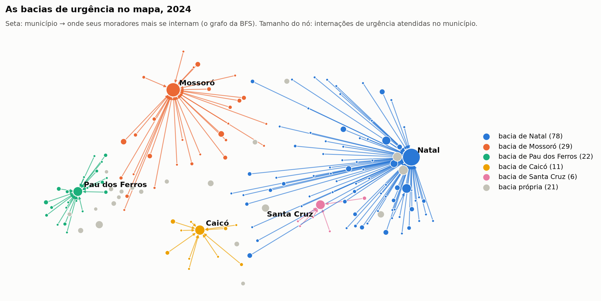
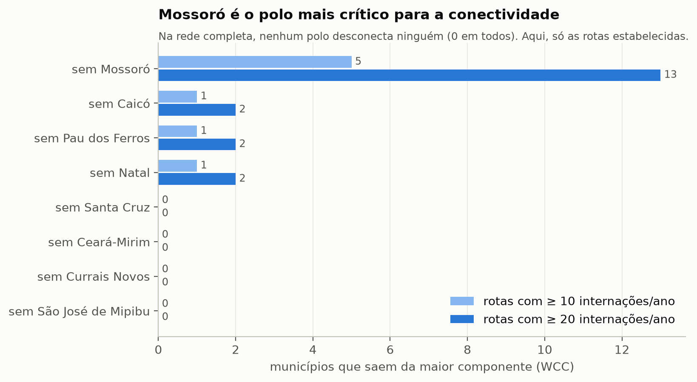
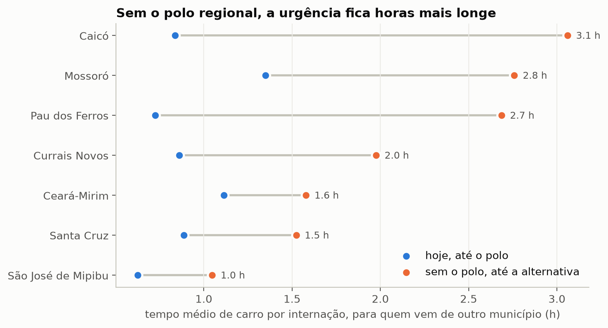

# Quem sustenta a urgência no RN? Fluxo de internações do SUS entre municípios

Projeto da Unidade 01 de **Algoritmos e Estruturas de Dados II** (DCA3702, UFRN), prof. Ivanovitch Silva, 2026.2.

## Integrantes

**LUIZ FELIPE DE SOUZA SILVA** 

## Vídeo

## Problema e pergunta

No Rio Grande do Norte, a maior parte dos municípios não tem hospital capaz de atender as próprias urgências: 83 dos 167 municípios não tiveram nenhuma internação de urgência no próprio município em 2024. O paciente é internado em outro lugar, quase sempre num punhado de polos.

**Pergunta.** Quais municípios sustentam o acesso à internação de urgência pelo SUS no RN, e quanto o acesso de cada município depende de um único polo? Se um polo deixar de atender, quantas internações são afetadas, quais municípios ficam sem alternativa e para onde os pacientes teriam de ir?

**Quem se beneficia.** A Secretaria de Saúde do RN (SESAP) e as Comissões Intergestores Regionais, que planejam a regionalização: quais polos não podem parar, onde reforçar a rede e quais municípios precisam de plano de contingência.

**Por que é uma pergunta de rede.** A resposta não está no tamanho de cada município isolado, e sim em quem manda pacientes para quem: se um polo para, o dano depende de quais municípios dependem dele e de quais alternativas eles já usam.

## Dados

| dado | fonte | como é obtido |
|---|---|---|
| Internações hospitalares (AIH reduzida, arquivo RD), RN, 12 meses de 2024 | SIH/SUS, DATASUS | FTP `ftp.datasus.gov.br/dissemin/publicos/SIHSUS/200801_/Dados` (`01_coleta`, seção 1) |
| Caráter da internação (`CAR_INT`) | tabela `CARATEND.CNV` do `TAB_SIH.zip` (DATASUS) | `01_coleta`, seção 5 |
| Nomes e códigos dos municípios | API de localidades do IBGE | `01_coleta`, seção 6 |
| Coordenadas das sedes | [kelvins/municipios-brasileiros](https://github.com/kelvins/municipios-brasileiros) | `01_coleta`, seção 8 |
| Distância e tempo de carro entre as sedes (167 × 167) | OSRM, servidor público ([project-osrm.org](https://project-osrm.org)) | `01_coleta`, seção 9 |
| Nomes dos hospitais (CNES) | API de dados abertos do Ministério da Saúde | `01_coleta`, seção 10 |

**Limpeza** (`01_coleta` e `02_rede`):

- 216.884 AIHs baixadas; saem as AIHs de continuação (891) e os residentes de outros estados (1.959). Ficam **214.034 internações**.
- Só as colunas usadas: competência, município de residência e de internação, hospital (CNES), CID principal, caráter da internação, tipo de AIH e data.
- Caráter da internação classificado em **eletiva** (`01`) e **urgência** (`02` urgência, `05` acidente de trânsito, `06` outras lesões e envenenamentos). Os códigos `03` e `04` não aparecem no RN em 2024.
- Checagens: nenhum código de município inválido; 93,9% das AIHs têm data de internação em 2024 (o arquivo é organizado pelo mês de processamento).
- As respostas do OSRM e da API do CNES ficam salvas em `data/processed/`; as APIs só são consultadas para o que ainda não está no arquivo.

## Modelagem

| elemento | escolha | por quê |
|---|---|---|
| **Nó** | município do RN (167) | é a unidade em que a regionalização é planejada |
| **Aresta** | residência → internação, só quando os municípios são diferentes | representa o paciente que precisa sair do município para ser internado |
| **Direção** | dirigida | "A manda pacientes para B" não é o mesmo que "B manda para A" |
| **Peso** | número de internações no ano | volume do fluxo; para caminhos (closeness, betweenness), distância = 1/peso |
| **Internação no próprio município** | atributo `locais` do nó, e não laço | não entra no grau, na densidade nem nos caminhos; aparece na diagonal da matriz de adjacência (autossuficiência) |
| **Camadas** | urgência e eletiva (rede multicamada) | a pergunta é sobre urgência; a eletiva tem polos de mutirão que distorcem o agregado |
| **Rede bipartida** | município de residência ↔ hospital (CNES) | quem atende de fato é o hospital; serve para achar hospitais com áreas de origem semelhantes |

**O que ficou de fora:** internações por plano de saúde ou particulares (o SIH só registra o SUS), demanda reprimida (quem não conseguiu vaga), AIHs de continuação e residentes de outros estados.

**Alternativas consideradas e o efeito das escolhas**

- **Multicamada contra rede agregada.** Na rede total, Almino Afonso, Currais Novos e Santo Antônio parecem polos regionais. Separando as camadas, eles são polos de mutirão eletivo (catarata e vesícula, um hospital cada) e somem da urgência. Por isso a análise usa a camada de urgência.
- **Bipartida.** A rede município → município diz qual cidade é polo; a projeção da rede município ↔ hospital diz quais hospitais atendem as mesmas populações. As duas apontam as mesmas alternativas regionais.
- **Temporal.** A rede é anual (12 meses de 2024). Uma rede por mês mostraria sazonalidade, mas cada mês teria poucas internações por ligação; fica como próximo passo.
- **Filtro de "rota estabelecida".** Na rede completa, um único paciente no ano já cria uma aresta. Para dizer se um município "tem alternativa", contamos só as ligações com pelo menos 10 internações no ano (`LIMIAR`). Esse limiar é uma escolha do projeto, e a seção 8 testa de 1 a 30.
- **Representações não dirigidas.** Nas análises de k-core e Jaccard deste projeto utilizamos representações não dirigidas; nessas seções a interpretação muda (trocar pacientes de forma entrelaçada, atender os mesmos municípios), e isso está escrito no notebook.

## Conteúdo do curso utilizado

A coluna "onde aparece" indica o notebook e a seção (os títulos das seções estão numerados no notebook).

| conceito | semana | onde aparece | para que serviu |
|---|---|---|---|
| Grafo dirigido e ponderado, atributos de nó | 2 | `02_rede.ipynb`, seções 2–4; `03_analise.ipynb`, seção 1.1 (`construir_rede`) | modelar o fluxo residência → internação com o volume como peso |
| Rede multicamada e subgrafo | 2 | `03_analise.ipynb`, 1.1 | separar urgência e eletiva; revelou os polos de mutirão eletivo |
| Densidade e esparsidade | 2 | `03_analise.ipynb`, 1.2 | 96% dos pares de municípios não trocam paciente de urgência: a rede é esparsa |
| Grau de entrada e de saída, distribuição de grau | 2 | `03_analise.ipynb`, 1.3 | 52 municípios recebem pacientes e 115 só enviam |
| Matriz de adjacência | 2 | `03_analise.ipynb`, 1.4 | diagonal = autossuficiência; blocos = bacias; matriz agregada por bacia |
| BFS (`bfs_layers`) | 3 | `03_analise.ipynb`, 1.4 | formar as bacias de atendimento: cada município aponta para onde seus moradores mais se internam, e a BFS parte de cada polo **contra o sentido dessas setas** (grafo invertido), alcançando quem manda pacientes para ele; mostrou que as bacias são estrelas |
| Componentes conexas, GCC, WCC e SCC | 4 | `03_analise.ipynb`, 3.1 | a rede é um bloco só, mas só 38 municípios trocam pacientes nos dois sentidos |
| Remoção de nós ("quanto aguenta antes de virar arquipélago") | 4 | `03_analise.ipynb`, 3.2 e 5.3 | Mossoró é o polo cuja remoção isola mais municípios |
| Centralidades: grau, força, closeness, betweenness | 4 | `03_analise.ipynb`, 4.1–4.4 | quem parece importante: volume, alcance e pontes |
| Distribuição de centralidade (ECDF) | 4 | `03_analise.ipynb`, 4.5 | muitos municípios pequenos e poucos hubs |
| Centralidade contra remoção ("vale a pena proteger os hubs?") | 4 | `03_analise.ipynb`, 4.6 e 5.3 | a centralidade aponta candidatos; a remoção mostra quem é crítico |
| k-core, k-shell, degenerescência | 5 | `03_analise.ipynb`, seção 6 | núcleo de 19 municípios; "hub não é núcleo" (Pau dos Ferros e Caicó) |
| Gephi | 5 | `03_analise.ipynb`, seção 9 (export `.graphml`) | visualização da rede com os atributos calculados |
| Rede bipartida, projeção, artefato do clique, Jaccard | 6 | `03_analise.ipynb`, seção 7 | hospitais com áreas de origem semelhantes; substitutos regionais |
| Esqueleto por limiar de peso | 6 | `03_analise.ipynb`, seções 3.2, 7.5 e 8 | separar rotas estabelecidas de casos isolados e testar a robustez das conclusões |

Fora do curso: tempo de viagem por estrada (OSRM) e o cenário de redistribuição da seção 5, que usam a rede para estimar quanto custa a alternativa.

## Como executar

Python 3.12. Na raiz do repositório:

```bash
python -m venv .venv
# Windows: .venv\Scripts\activate    Linux/macOS: source .venv/bin/activate
pip install -r requirements.txt
jupyter nbconvert --to notebook --execute --inplace 01_coleta.ipynb 02_rede.ipynb 03_analise.ipynb
```

- `01_coleta` precisa de internet (FTP do DATASUS, IBGE, OSRM e CNES). Os arquivos `.dbc` brutos ficam em `data/raw/` (fora do git) e não são baixados de novo se já existirem.
- Os dados processados estão no repositório (`data/processed/`). Para reproduzir só a rede e a análise, sem internet (cerca de 30 segundos):

```bash
jupyter nbconvert --to notebook --execute --inplace 02_rede.ipynb 03_analise.ipynb
```

Todas as figuras de `figures/` são geradas pelo `03_analise` (e `00_rede_rn.png` pelo `02_rede`).

**Estrutura**

```
01_coleta.ipynb        download e limpeza (SIH, IBGE, coordenadas, OSRM, CNES)
02_rede.ipynb          construção da rede agregada e primeiras medidas
03_analise.ipynb       análise completa, seções 1 a 10
data/raw/              arquivos .dbc do DATASUS (não versionados)
data/processed/        dados limpos, distâncias, hospitais e redes .graphml para o Gephi
figures/               figuras do notebook de análise
requirements.txt       dependências com versões fixadas
```

## Resultados

**1. Quem sustenta o acesso.** Natal recebe metade das internações de urgência entre municípios (33.471 em 2024) e Mossoró, 20% (13.340); os 5 maiores polos recebem 85%. A BFS organiza os municípios em 5 bacias grandes: Natal (78), Mossoró (29), Pau dos Ferros (22), Caicó (11) e Santa Cruz (6). As bacias são estrelas: 140 dos 141 municípios que não são polo apontam direto para o polo.



**2. Quanto cada município depende de um polo.** 83 municípios não tiveram nenhuma internação de urgência no próprio município. 129 mandam mais da metade das urgências que saem do município para um único polo, e 65 mandam mais de 70%. Ter muitos destinos não é independência: Parnamirim manda pacientes para 15 municípios, mas 97% do que sai vai para Natal.

**3. Se um polo parar.**

| polo | internações afetadas por ano | tempo médio de quem vem de fora | municípios isolados (rotas ≥ 10/ano) |
|---|---|---|---|
| Natal | 60 mil | 1,3 h → 0,9 h, mas Macaíba teria de atender 7,8× o volume atual | 1 |
| Mossoró | 24 mil | 1,4 h → 2,8 h (moradores de Mossoró: 4,1 h) | 5 |
| Caicó | 5,7 mil | 0,8 h → 3,1 h | 1 |
| Pau dos Ferros | 4,7 mil | 0,7 h → 2,7 h | 1 |



**4. Dois tipos de polo crítico.** As centralidades colocam Natal em 1º lugar em todas as medidas, mas a remoção separa duas criticidades: **Mossoró é o mais crítico para a conectividade** (sem ele, Tibau, Governador Dix-Sept Rosado, Triunfo Potiguar, Paraú e Janduís ficam sem rota estabelecida; 13 municípios com rotas de pelo menos 20 internações), e **Natal é o mais crítico para a carga** (quase ninguém fica sem rota, mas nenhum vizinho absorve o volume).



**5. No nível de hospital.** Natal e Mossoró têm redundância territorial de cobertura: vários hospitais da mesma cidade atendem os mesmos municípios. O ponto único é o Hospital Regional de Pau dos Ferros: atende mais da metade das urgências de 10 municípios, e sem ele 5 teriam de ir a outra cidade (1,4 h a mais) e Viçosa ficaria sem rota.

**Prioridades para a gestão:** Mossoró (conectividade do oeste), Pau dos Ferros e Caicó (tempo de viagem; Pau dos Ferros depende de Mossoró como alternativa) e Natal (carga). A síntese completa está na seção 10 do `03_analise.ipynb`.

## Limitações e próximos passos

**Limitações**

- **Competência.** O SIH organiza as AIHs por mês de processamento: 6% das AIHs de 2024 são de internações de 2023.
- **Unidade.** A unidade é a AIH, não o paciente: transferências e reinternações contam de novo.
- **Só o que aconteceu.** O SIH registra internações realizadas pelo SUS; não mede demanda reprimida nem o setor privado.
- **Urgência inclui partos.** Por isso maternidades regionais aparecem como polos de urgência.
- **Rota estabelecida.** O limiar de 10 internações por ano é uma escolha do projeto; o número de internações "sem rota" muda com ele (seção 8), e os polos e tempos de viagem não.
- **Redistribuição é hipótese.** O cenário supõe que os pacientes seguem as alternativas que o município já usa, na mesma proporção; na prática, a regulação estadual decide.
- **Carga não é capacidade.** "7,8×" compara com o volume atendido hoje, não com o número de leitos.
- **Distância.** Tempo de carro entre as sedes dos municípios, não da casa do paciente ao hospital.
- **Betweenness.** Caminhos de vários passos não são trajetos de pacientes; a medida indica posição estrutural.
- **Jaccard.** É binário (presença do município, não volume) e mede se dois hospitais atendem a mesma população, não se oferecem o mesmo serviço.
- **k-core.** A hierarquia de núcleos depende das ligações fracas (seção 8).

**Próximos passos**

- Rede por mês (temporal), para ver sazonalidade e meses em que os polos ficam mais carregados.
- Refazer os cenários sem partos (capítulo O da CID), que são cerca de 30% da urgência entre municípios.
- Cruzar com leitos do CNES, para trocar "carga" por ocupação.
- Testar remoções em grupo (por exemplo, Mossoró e Pau dos Ferros juntos) e por região de saúde.
- Comparar hospitais por especialidade (grupo de CID ou procedimento), para separar substitutos de cobertura de substitutos clínicos.

## Referências

- Material do curso: [github.com/ivanovitchm/datastructure](https://github.com/ivanovitchm/datastructure) (lesson03, wikipedia, practice, hubs, lesson07, lesson08).
- Coscia, M. *The Atlas for the Aspiring Network Scientist*. [networkatlas.eu](https://www.networkatlas.eu/).
- Newman, M. *Networks*. 2. ed. Oxford University Press, 2018.
- DATASUS. Sistema de Informações Hospitalares (SIH/SUS), arquivos RD e informe técnico `IT_SIHSUS_1603`. `ftp.datasus.gov.br/dissemin/publicos/SIHSUS/200801_/`.
- IBGE. API de localidades: `servicodados.ibge.gov.br/api/v1/localidades`.
- Ministério da Saúde. API de dados abertos, CNES: `apidadosabertos.saude.gov.br`.
- kelvins. *municipios-brasileiros*: [github.com/kelvins/municipios-brasileiros](https://github.com/kelvins/municipios-brasileiros).
- OSRM, Open Source Routing Machine: [project-osrm.org](https://project-osrm.org).
- Hagberg, A., Schult, D., Swart, P. *NetworkX*. [networkx.org](https://networkx.org).
